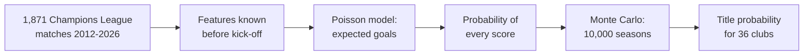

# 🏆 Who will win the 2026-27 Champions League?

[](https://github.com/moussa197/CHAMPIONS-/actions/workflows/tests.yml)


A data science project that predicts the score of every UEFA Champions League match, then simulates the whole 2026-27 season **10,000 times** to estimate each of the 36 clubs' chances of winning the title, before the competition starts.

**▶ Live demo:** _add the Streamlit link here after deployment_
**🇫🇷 Full documentation in French:** [README.fr.md](README.fr.md)

---

## Key results

| | |
|---|---|
| **Match outcome accuracy** (win / draw / loss, 502 unseen matches, 2023-2026) | **60.4 %** |
| Pinnacle, the reference bookmaker, on the same matches | 60.2 % |
| Naive baseline (always the most frequent outcome) | 50.0 % |
| Log loss (lower is better) | **0.893** vs 1.020 for the baseline |
| **Title favourite for 2026-27** | **Arsenal, 25 %** (23 to 27 % with model uncertainty) |
| Next | Bayern Munich 14.9 % · Manchester City 13.9 % · Barcelona 12.5 % |

The model matches the bookmakers' accuracy without knowing injuries or line-ups, which suggests that ~60 % is close to the ceiling for predicting football results.

---

## How it works



1. **Features, all computed from past matches only (no leakage):**
   - **Elo rating**: each club's overall strength;
   - **Attack and defence strengths**: learned every month on ~18,000 club matches of the previous 3 years, domestic leagues included;
   - **Value of the players who actually play**: Transfermarkt value of the 11 most-used players over the last 5 matches, a proxy for injuries and rotation;
   - home advantage and the new 36-club format (+13 % goals since 2024).
2. **Poisson regression** gives each team's expected goals (e.g. PSG 1.80 – Barcelona 1.62), then the probability of every score from 0-0 to 10-10, then win / draw / loss (43 % / 22 % / 35 %). Scores, not just winners, are needed to simulate goal difference, two-legged ties and extra time.
3. **Monte Carlo simulation** of the full season: the 144 real league-phase fixtures, play-offs, knockout bracket (two legs, extra time, penalties, neutral final), with Elo updated after every match.

---

## Model performance

All figures below are measured on the **test set: 502 Champions League matches from 2023-24 to 2025-26** that the model never saw during training or model selection.

### Match outcome (win / draw / loss)

| Model | Accuracy | Log loss ↓ |
|---|---|---|
| Naive baseline (always the most frequent outcome) | 50.0 % | 1.020 |
| Rule "the club with the higher Elo wins" | 58.8 % | – |
| Ordinal logistic regression (Elo + home) | 58.2 % | 0.904 |
| Poisson regression (Elo + home) | 58.6 % | 0.902 |
| **Final Poisson model (+ attack/defence strengths + current players' value)** | **60.4 %** | **0.893** |
| Pinnacle (bookmaker closing odds) | 60.2 % | 0.891 |
| Bet365 (bookmaker closing odds) | 60.4 % | 0.892 |

- **No overfitting:** 58.8 % on the training seasons, 59.7 % in rolling validation, 60.4 % on the test set.
- **The gain over the Elo-only model is real:** +0.0098 log loss, 95 % bootstrap interval from +0.0015 to +0.0181 (entirely above zero).
- **Confirmed on the latest season:** 60.1 % on 2025-26 alone.
- **On par with the bookmakers:** the log-loss gap with Pinnacle is +0.002 (95 % interval −0.013 to +0.017, which contains zero), and blending our model with their odds does not help.
- **Why log loss and not accuracy to choose models:** on 502 matches an accuracy is only known within about ±4.3 points, and log loss also rewards honest probabilities.

### Scores and goals

| | Model | Reality / baseline |
|---|---|---|
| Exact score predicted | **9.8 %** of matches | 6.6 % for "always 1-1" |
| Goals per team, mean absolute error | **1.02** | 1.16 for a mean-goals baseline |
| Draws | 21.6 % predicted | 17.1 % observed |
| 1-1 | 10.2 % predicted | 6.6 % observed |
| 0-0 | 5.5 % predicted | 4.8 % observed |

The exact score is right about one time in ten, which is expected with dozens of possible scores: this is why the app always shows the 5 most likely scores rather than a single one.

### Season simulation (backtest)

Replaying 2024-25 and 2025-26 from September with a model trained only on earlier seasons:

| | 2024-25 | 2025-26 |
|---|---|---|
| Real quarter-finalists among our 8 favourites | 5 / 8 | 6 / 8 |
| Brier score for reaching the quarter-finals (↓) | 0.112 | 0.091 |
| Uniform baseline | 0.173 | 0.173 |

For the title itself, two seasons are too few to conclude: the Brier score is worse than the uniform baseline in 2024-25 (0.0302 vs 0.0270) and slightly better in 2025-26 (0.0265 vs 0.0270).

---

## Methodology highlights

- **Time-aware evaluation**: rolling validation on 8 seasons (2015-2022), then a final test on 2023-2026 used **only once**.
- **A selection rule fixed in advance**: a feature is kept only if it improves the validation log loss **and** wins on at least 5 seasons out of 8.
- **Tested and rejected with evidence**: recent form, fatigue, full squad value, coach tenure and quality, Random Forest, XGBoost, Dixon-Coles, bivariate Poisson, negative binomial, blending with bookmaker odds, weather (data not available).
- **Uncertainty quantified**: 100 coefficient draws from the model's covariance × 2,000 seasons each, plus 12 sensitivity scenarios. Arsenal stays first in all of them.
- **Backtested**: replaying 2024-25 and 2025-26 from September, the simulation finds 5 and 6 of the 8 quarter-finalists among its 8 favourites (1.8 expected by chance).
- **Audited** by a team member acting as a "red team" (target shuffling, leakage checks).
- **Reproducible**: fixed seeds, unit tests run on every push, and the app checks at start-up that its probabilities match the model's exported predictions to 0.001.

### Limitations

- Knockout matches: only 118 in the test set, too few to prove the model beats the baseline there, although that is where the title is decided.
- Draws are slightly over-predicted (21.6 % predicted vs 17.1 % observed): goals keep rising each season and the model lags one season behind.
- No line-ups, summer transfers or match stakes.

---

## The app

A Streamlit app with three pages:

- **Predict a match**: pick two clubs and see win / draw / loss probabilities, expected goals, the **5 most likely scores**, the chance of 3+ goals and of both teams scoring;
- **League phase 2026-27**: the 144 official fixtures, filterable by matchday and club;
- **Simulation**: the favourites and every club's probability of reaching each round.

Run it locally:

```bash
python -m pip install -r app/requirements.txt
python -m streamlit run app/app.py
```

The app only reads the small exported files in `output/` (model coefficients and predictions); it never retrains the model.

---

## Repository structure

```
CHAMPIONS-/
├── analyse/        # Jupyter notebooks: EDA, features, model, audit, simulation, uncertainty
├── app/            # Streamlit app and its requirements
├── output/         # Files read by the app (model coefficients, predictions, simulation)
├── tests/          # Reproducibility tests of the simulation
├── prompts.md      # AI prompts used, with what we checked and corrected
└── README.fr.md    # Full documentation in French (data, run order, detailed results)
```

To rebuild everything from the raw data, download the Kaggle datasets below into `data/`, install `requirements.txt` and run the notebooks in the order given in [README.fr.md](README.fr.md#️-ordre-dexécution).

**Data sources (Kaggle):** [Football Data from Transfermarkt](https://www.kaggle.com/datasets/davidcariboo/player-scores) · [Club Football Match Data 2000-2025](https://www.kaggle.com/datasets/adamgbor/club-football-match-data-2000-2025) · [Football Odds Movements 2018-2026](https://www.kaggle.com/datasets/archangel0x01/football-odds-movements-2018-2026) (comparison only). Raw data is not redistributed in this repository.

---

## Team

Group project at ESEO (engineering school), September–October 2026.

| Member | Contribution |
|---|---|
| **Moussa** | Elo ratings, attack/defence strengths, score model (Poisson), bookmaker comparison |
| **Maxime** | Season simulation engine and backtests |
| **Loan** | Recent form, EDA v2, model audit, uncertainty and sensitivity analysis |
| **Mouhamedou** | Player features and Streamlit app |
| **Ousmane** | Fatigue and schedule features |

AI assistants were used to write code; every figure was recomputed and checked in notebooks that run end to end, and every modelling decision was made by the team (see [prompts.md](prompts.md)).

**Tech stack:** Python · pandas · NumPy · scikit-learn · statsmodels · SciPy · XGBoost · Matplotlib · Streamlit · Jupyter

## License

[MIT](LICENSE)
